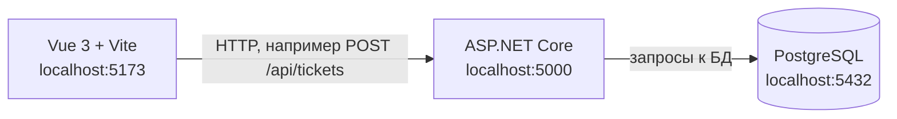

# Архитектура

архитектура web-ИС семестра

## Пояснение

Vue рисует экраны (список, создание, вход) и отправляет HTTP-запросы. ASP.NET Core проверяет правила: права ролей, допустимые переходы статуса, длину полей. PostgreSQL хранит данные. Прямой стрелки от браузера к базе нет: иначе клиент получил бы доступ к данным и обошёл бы серверные правила.