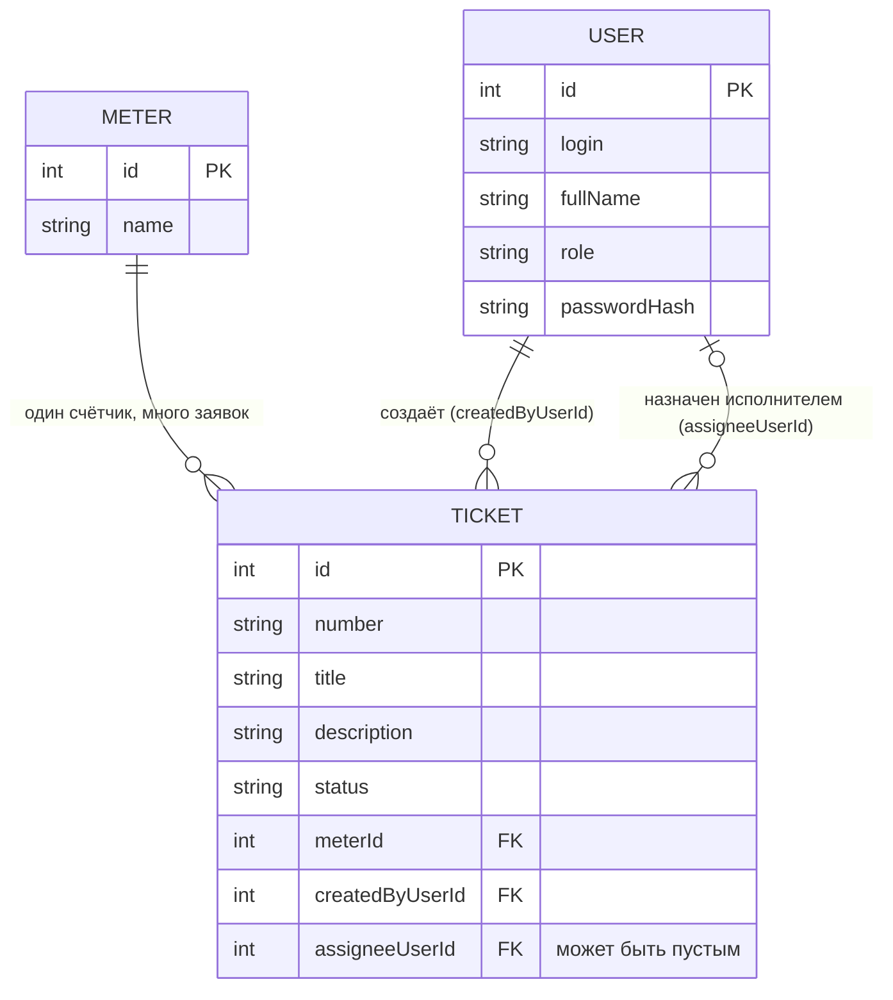

# Модель данных

Курс: 4 КГЭУ · ЛР2
Тема: заявки на проверку аномального энергопотребления

## Словарь проекта

| Термин курса | Термин моей темы |
| ------------ | ---------------- |
| Ticket       | заявка на проверку аномалии |
| Site         | прибор учёта (счётчик), в API `meter` |
| User         | диспетчер / главный энергетик / инженер-энергетик |

Дальше во всех документах используются только эти термины.

## ER-диаграмма

## Связи словами

- Один счётчик (`Meter`) — много заявок (`Ticket`).
- Один пользователь создаёт много заявок (`createdByUserId`).
- Один пользователь может быть назначен исполнителем на много заявок (`assigneeUserId`).
- У новой заявки исполнитель отсутствует: `assigneeUserId` = NULL.

## Поля

**Ticket:** `id` (PK, число, создаёт БД), `number` (человеческий номер вида АН-2026-0001, уникальный), `title` (5–80), `description` (10–500), `status` (`New`, `InProgress`, `Closed`, `Cancelled`), `meterId` (FK на Meter), `createdByUserId` (FK на User), `assigneeUserId` (FK на User, может быть пустым).

**Meter:** `id` (PK), `name` (название или номер счётчика, например «Корпус А, ввод 1»).

**User:** `id` (PK), `login` (уникальный), `fullName`, `role` (`Dispatcher`, `ChiefEnergist`, `Engineer`), `passwordHash`.

`id` и `number` — разные поля: `id` нужен машине для связей, `number` читает человек.

## Проверка 3НФ

Название счётчика хранится в сущности Meter один раз. Ticket содержит внешний ключ `meterId`. При переименовании счётчика меняется одна строка, поэтому текст названия не дублируется в заявках. ФИО пользователей тоже хранятся один раз в User, а в заявке только `createdByUserId` и `assigneeUserId`.